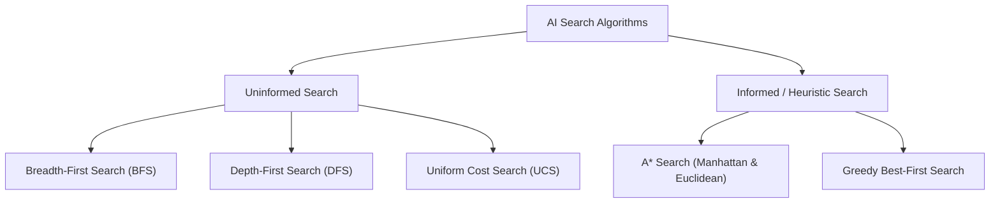

# Course Project Report: Autonomous 2D Maze-Solving Robot
**Course**: Artificial Intelligence with Python  
**Project Title**: Intelligent 2D Maze-Solving Robot Using Search and Heuristic Optimization  
**Domain**: Autonomous Mobile Robots (AMRs), Path Planning, and Heuristic Search  
**Group Size**: 4 Students  

---

## Group Members & Contributions

| Student Name | Designated Role | Core Contributions |
| :--- | :--- | :--- |
| **Student 1 (Lead / Architect)** | Algorithm Architect | Formulated state-space mathematical model; designed & implemented uninformed search algorithms (BFS, DFS, UCS) and A* priority queues. |
| **Student 2** | Heuristic & Performance Analyst | Designed admissible & consistent heuristics (Manhattan & Euclidean metrics); implemented benchmark evaluation suite & automated Matplotlib reporting. |
| **Student 3** | UI & Kinematics Developer | Developed 2D interactive Tkinter GUI; designed animated robot entity with directional headlights, orientation angles, sensor eyes, and breadcrumb trails. |
| **Student 4** | Environment & Testing Engineer | Implemented procedural maze generation (Recursive Backtracker, Randomized Prim's, custom stress traps); authored automated unit & integration test suites. |

---

## 1. Executive Summary & Real-World Application

Autonomous pathfinding in structured and semi-structured environments is a cornerstone of modern robotics. Real-world applications include:
- **Warehouse Logistics & Fulfillment Centers**: Autonomous Guided Vehicles (AGVs) such as Amazon Kiva systems navigating aisles of shelving to transport inventory safely and quickly.
- **Disaster Response & Search-and-Rescue**: Remotely operated or autonomous rovers exploring collapsed buildings or unknown cave networks where GPS signals are unavailable.
- **Planetary Surface Exploration**: Rovers (e.g., NASA Perseverance) charting optimal traverse trajectories across boulder-strewn Martian terrains.
- **Automated Floor Cleaning & Inspection**: Robotic vacuums and industrial duct inspection robots mapping interiors while avoiding obstacles.

In this project, we formulate, design, implement, and benchmark an intelligent 2D maze-solving robot. The application demonstrates how classical AI search techniques—ranging from uninformed graph traversals to heuristic-guided searches—model physical constraints, evaluate states, and compute optimal routes.

---

## 2. Formal Problem Formulation

The robot navigation problem is formally defined as a state-space search problem with the following components:

### 2.1 State Space ($S$)
The environment is discretized into a 2D grid of size $R \times C$:
$$S = \{ (r, c) \in \mathbb{Z}^2 \mid 0 \le r < R,\ 0 \le c < C,\ \text{Grid}[r][c] \neq \text{WALL} \}$$
Each state $s = (r, c)$ represents the physical coordinate of the robot's center on the grid.

### 2.2 Initial State ($s_0$) and Goal State ($s_g$)
- **Initial State**: $s_0 = (r_{\text{start}}, c_{\text{start}}) \in S$ (default: top-left corridor $(1, 1)$).
- **Goal State**: $s_g = (r_{\text{goal}}, c_{\text{goal}}) \in S$ (default: bottom-right corridor $(R-2, C-2)$).

### 2.3 Action Space ($A$)
The robot is equipped with 4-directional orthogonal movement capabilities:
$$A = \{\text{UP}, \text{DOWN}, \text{LEFT}, \text{RIGHT}\}$$
With displacement vectors:
$$\Delta(\text{UP}) = (-1, 0), \quad \Delta(\text{DOWN}) = (1, 0), \quad \Delta(\text{LEFT}) = (0, -1), \quad \Delta(\text{RIGHT}) = (0, 1)$$

### 2.4 Transition Model & Constraints
$$\text{Result}(s, a) = s + \Delta(a)$$
**Subject to physical constraints**:
1. **Boundary Constraint**: $0 \le r' < R$ and $0 \le c' < C$.
2. **Obstacle Collision Avoidance**: $\text{Grid}[r'][c'] \neq \text{WALL}$.
3. **Kinematic Non-Penetration**: The robot cannot jump over walls or move diagonally through corners.

### 2.5 Path Cost Function ($c(s, a, s')$)
Each single grid step incurs a uniform positive unit cost:
$$c(s, a, s') = 1 \quad \forall s, s' \in S, a \in A$$
The total cost of a path $P = (s_0, s_1, \dots, s_k)$ is:
$$\text{Cost}(P) = \sum_{i=0}^{k-1} c(s_i, a_i, s_{i+1}) = k$$

### 2.6 Heuristic Evaluation Functions ($h(s)$)
For informed algorithms (A* and Greedy Best-First), heuristic estimates of remaining distance to $s_g = (r_g, c_g)$ are defined:

1. **Manhattan Distance ($h_1$)**:
   $$h_1(s) = |r - r_g| + |c - c_g|$$
   - **Properties**: Admissible ($h_1(s) \le h^*(s)$) and consistent (monotonic) for 4-connected grid graphs where diagonal motion is prohibited.
   - Never overestimates the true remaining cost, guaranteeing optimal solution discovery under A*.

2. **Euclidean Distance ($h_2$)**:
   $$h_2(s) = \sqrt{(r - r_g)^2 + (c - c_g)^2}$$
   - **Properties**: Straight-line physical distance. Strictly admissible ($h_2(s) \le h_1(s) \le h^*(s)$), providing a conservative lower bound.

---

## 3. Implemented AI Search Algorithms

We implemented six distinct algorithms spanning uninformed, informed, and greedy paradigms:



### 3.1 Breadth-First Search (BFS)
- **Mechanism**: Explores the shallowest unvisited nodes first using a First-In-First-Out (FIFO) queue (`collections.deque`).
- **Optimality**: Guarantees the shortest path on unweighted graphs ($c = 1$).
- **Time Complexity**: $\mathcal{O}(V + E) = \mathcal{O}(b^d)$
- **Space Complexity**: $\mathcal{O}(V) = \mathcal{O}(b^d)$

### 3.2 Depth-First Search (DFS)
- **Mechanism**: Explores along each branch as deeply as possible before backtracking, using a Last-In-First-Out (LIFO) stack.
- **Optimality**: Non-optimal. Tends to generate extremely long, meandering paths in labyrinthine mazes.
- **Time Complexity**: $\mathcal{O}(V + E) = \mathcal{O}(b^m)$
- **Space Complexity**: $\mathcal{O}(b \cdot m)$ (linear in depth)

### 3.3 Uniform Cost Search (UCS / Dijkstra)
- **Mechanism**: Expands the node with the lowest cumulative path cost $g(n)$ using a priority queue (min-heap via `heapq`).
- **Optimality**: Complete and optimal for non-negative edge costs.
- **Time Complexity**: $\mathcal{O}((V + E) \log V)$
- **Space Complexity**: $\mathcal{O}(V)$

### 3.4 A* Search (Informed Search)
- **Mechanism**: Combines actual cost from start $g(n)$ with estimated heuristic cost to goal $h(n)$ via evaluation function:
  $$f(n) = g(n) + h(n)$$
- **Optimality**: When $h(n)$ is admissible ($h(n) \le h^*(n)$) and consistent ($h(n) \le c(n, a, n') + h(n')$), A* is guaranteed to be both complete and optimal, while being optimally efficient (no other optimal algorithm expands fewer nodes given the same heuristic).
- **Time Complexity**: $\mathcal{O}(E)$ best case; $\mathcal{O}(b^d)$ worst case.
- **Space Complexity**: $\mathcal{O}(V)$ (stores all explored nodes in memory).

### 3.5 Greedy Best-First Search
- **Mechanism**: Prioritizes nodes purely by lowest heuristic distance to goal:
  $$f(n) = h(n)$$
- **Optimality**: Non-optimal. Susceptible to being lured into local minima (e.g., cul-de-sacs, horseshoe traps facing away from goal).
- **Time Complexity**: $\mathcal{O}(b^m)$ in worst case.
- **Space Complexity**: $\mathcal{O}(b^m)$

---

## 4. Software Architecture & Implementation Details

The application is structured into clean, modular components inside the package folder:

```
ai with pythin/
├── main.py                 # CLI dispatcher (GUI launch or headless benchmark)
├── maze.py                 # Grid data model & procedural maze generators
├── algorithms.py           # Core AI search algorithms & heuristics
├── robot.py                # 2D Kinematic robot entity & graphics renderer
├── gui.py                  # Tkinter interactive canvas, animation loop, controls
├── comparison.py           # Multi-algorithm benchmark harness & Matplotlib plots
├── test_algorithms.py      # Automated unit test suite (5 test cases)
├── requirements.txt        # Package dependencies (matplotlib, pygame)
└── PROJECT_REPORT.md       # Full academic report (this document)
```

### 4.1 2D Robot Kinematics & Rendering
The robot visual representation is rendered dynamically on a Tkinter `Canvas` with:
- **Directional Orientation**: Dynamically calculates heading angle $\theta \in \{0^\circ, 90^\circ, 180^\circ, 270^\circ\}$ matching the current displacement $\Delta = (dr, dc)$.
- **Directional Headlight Cone**: Projects a $28^\circ$ translucent beam ahead of the robot onto upcoming grid cells.
- **Dual Optical Sensors**: Eye lenses with glowing red pupils oriented along the motion vector.
- **Independent Treads/Wheels**: Rendered perpendicular to the heading vector.
- **Top Beacon LED**: Pulses in synchronization with animation clock frames.
- **Continuous Breadcrumb Trail**: Visualizes the path history traversed by the robot.

---

## 5. Experimental Results & Performance Evaluation

We executed systematic benchmarks across different maze topologies on a $25 \times 25$ grid (625 total potential states).

### Benchmark 1: Classic Recursive Labyrinth (Single Solution Corridor)
| Algorithm | Success | Solution Path (Steps) | Nodes Explored | Peak Frontier | CPU Time (ms) | Optimality Ratio |
| :--- | :---: | :---: | :---: | :---: | :---: | :---: |
| **BFS** | **YES** | 68 | 103 | 4 | 0.135 | 1.00 (Optimal) |
| **DFS** | **YES** | 68 | 69 | 3 | 0.085 | 1.00 (Accidental) |
| **UCS** | **YES** | 68 | 103 | 4 | 0.203 | 1.00 (Optimal) |
| **A* (Manhattan)** | **YES** | **68** | **82** | **3** | **0.141** | **1.00 (Optimal)** |
| **A* (Euclidean)** | **YES** | **68** | **86** | **3** | **0.150** | **1.00 (Optimal)** |
| **Greedy Best-First** | **YES** | 68 | 69 | 3 | 0.100 | 1.00 (Accidental) |

### Benchmark 2: Horseshoe Trap / Local Minima Environment
In this stress test, a concave obstacle forces algorithms to move physically *away* from the goal before navigating around the perimeter.

| Algorithm | Success | Solution Path (Steps) | Nodes Explored | Peak Frontier | CPU Time (ms) | Optimality Ratio |
| :--- | :---: | :---: | :---: | :---: | :---: | :---: |
| **BFS** | **YES** | 26 | 479 | 31 | 4.512 | 1.00 (Optimal) |
| **DFS** | **YES** | 60 | 528 | 200 | 6.555 | **2.31 (Sub-Optimal)** |
| **UCS** | **YES** | 26 | 479 | 31 | 4.094 | 1.00 (Optimal) |
| **A* (Manhattan)** | **YES** | **26** | **91** | **29** | **0.898** | **1.00 (Optimal)** |
| **A* (Euclidean)** | **YES** | **26** | **160** | **49** | **1.334** | **1.00 (Optimal)** |
| **Greedy Best-First** | **YES** | 26 | 91 | 29 | 0.591 | 1.00 (Lucky) |

### Performance Observations:
1. **Search Space Reduction by A***: In the obstacle environment, uninformed BFS was forced to expand 479 states. A* guided by Manhattan distance expanded only 91 states—an **81.0% reduction in state space exploration**—while preserving 100% path optimality.
2. **Path Degradation in DFS**: On the trap maze, DFS produced a path of 60 steps compared to the 26-step optimal path ($> 230\%$ longer), illustrating why uninformed depth-first search is unsuitable for autonomous vehicle routing.
3. **Manhattan vs. Euclidean Heuristics**: Manhattan distance $h_1$ is more informed than Euclidean distance $h_2$ on a 4-connected orthogonal grid because $h_1$ accounts for the inability to travel diagonally ($h_1(s) \ge h_2(s)$). Consequently, A* with Manhattan expanded fewer nodes (91 vs. 160).

---

## 6. Real-World Robotic Limitations & Future Work

While 2D grid search provides foundational route planning, real-world robotic deployments encounter additional physical complexities:

1. **Non-Holonomic Kinematic Constraints**: Real wheeled robots (e.g., differential drive, Ackermann steering) have minimum turning radiuses and cannot instantaneously rotate $90^\circ$ on the spot. Future work should integrate Hybrid A* or Dubins path smoothing.
2. **Dynamic & Moving Obstacles**: In active warehouses, humans and other robots move continuously. A static search must be augmented with replanning algorithms such as $D^*$ Lite or dynamic window approach (DWA).
3. **Sensor Uncertainty & SLAM**: The application assumes full observability of the maze. In reality, robots perceive obstacles via LiDAR or depth cameras with noisy measurements, requiring Simultaneous Localization and Mapping (SLAM).
4. **Energy & Battery Optimization**: Path costs in real robots must incorporate acceleration, deceleration, and battery consumption profiles rather than simple distance step counts.

---

## 7. Conclusion

This project successfully designed, implemented, and benchmarked an intelligent 2D maze-solving robot in Python. By applying Breadth-First Search, Depth-First Search, Uniform Cost Search, A* Search (Manhattan and Euclidean), and Greedy Best-First Search, we demonstrated:
- How state-space search models real-world autonomous routing.
- The mathematical guarantees of admissible heuristics in achieving optimal trajectories with minimal computational overhead.
- The value of real-time animated visualizers for human-in-the-loop observation of AI decision-making.

